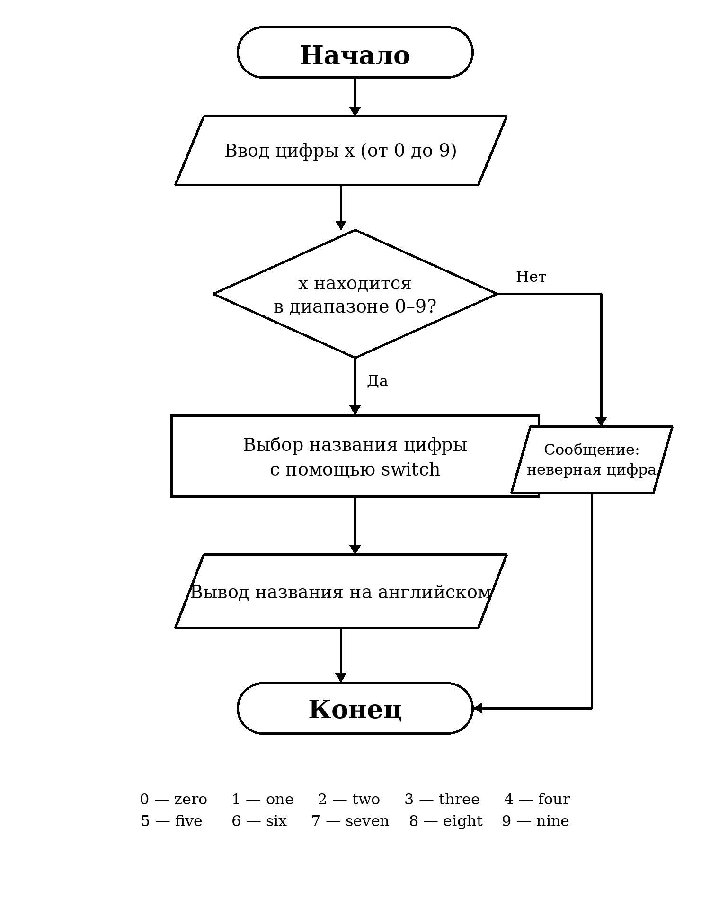

# Домашка к 7 лабе
### Вариант 4
Цель работы — разработать программу на языке C, которая позволяет вводить цифру от 0 до 9 и выводить её название на английском языке. Закрепить навыки использования условных операторов и оператора выбора.

Вывод: В ходе выполнения задания была разработана программа на языке C для перевода цифр от 0 до 9 в их английские названия. Были закреплены навыки работы с оператором выбора switch, ввода данных и вывода результатов на экран.
